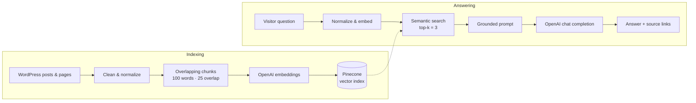

# Zara – The Future of Content Navigation

Hey there, content connoisseurs and tech aficionados! Welcome to **Zara** – the groundbreaking WordPress plugin that transforms the old, mundane menu navigation into an interactive quest for the perfect content. Forget aimlessly clicking around; with Zara, you simply answer a few fun questions, and voilà – your content is served on a silver platter!

<div align="center">
  
  <p>
    <a href="https://omayib.github.io/zara"><b>Website</b></a> ·
    <a href="https://github.com/omayib/zara/releases/latest"><b>Download</b></a> ·
    <a href="#under-the-hood"><b>Under the Hood</b></a> ·
    <a href="#about-the-developer"><b>About the Developer</b></a>
  </p>
</div>

---

## Description

Zara is not your average plugin – it's a cutting-edge, AI-powered assistant that makes content discovery a breeze. Built on a from-scratch Retrieval-Augmented Generation (RAG) pipeline, Zara turns your website into an intelligent guide that understands and directs your users to exactly what they need. And that's not all:

- **Seamless Integration:** Connects with Pinecone for vector storage.
- **Smart AI:** Utilizes OpenAI for embeddings and completions.
- **Interactive Experience:** Engages users with fun, dynamic questions.

Think of Zara as your personal digital concierge, making content exploration fun, fast, and fabulously smart!

---

## Under the Hood

Zara is a complete **Retrieval-Augmented Generation (RAG)** system written natively in PHP for WordPress, with no framework and no middleware. It talks straight to the model and vector database APIs, so every step of the pipeline is visible, tunable, and fast.



| Layer | What Zara does |
|---|---|
| **Text normalization** | Strips HTML, decodes entities, collapses whitespace, lowercases with Unicode awareness (`\p{L}\p{N}`), and expands English contractions so queries and documents land in the same semantic space. |
| **Chunking** | Splits content into 100-word windows with a 25-word overlap, so meaning that spans a boundary is never lost between chunks. |
| **Content-addressed vectors** | Each chunk's vector ID is the SHA-1 of its text. Re-indexing a post overwrites the same vectors instead of creating duplicates, which makes upserts idempotent. |
| **Embeddings** | OpenAI `text-embedding-ada-002` turns every chunk and every question into a dense vector. |
| **Vector search** | Pinecone runs nearest-neighbour search (top-k = 3) and returns the matching passages together with their source URLs. |
| **Grounded generation** | The best passage is injected into the prompt, so OpenAI's chat model answers from *your* content instead of guessing. |
| **Citations** | Source URLs are sanitized, de-duplicated, and returned as "related information" links next to the answer. |
| **Conversation analytics** | Every question, retrieved context, and answer is logged per visitor session and shown in the admin dashboard, so you can see what people ask and where content is missing. |
| **Selective sync** | Admins choose which posts are indexed and see each one's last-synced time. |

### Pluggable architecture

The RAG core is built on small interfaces and factories, so every provider can be swapped out without touching the pipeline:

```
EmbeddingGeneratorInterface   ← OpenAiEngine      (EmbeddingEngine::create('openai'))
ResponseGeneratorInterface    ← OpenAiEngine      (CompletionEngine::create('openai'))
VectorQueryInterface          ← PineconeEngine    (VectorEngine::create('pinecone'))
                    ↓ injected into
        AnswerFinder · IndexingContents
```

Adding Claude, a local model, Qdrant, or pgvector means implementing one interface and registering it in a factory; `AnswerFinder` and `IndexingContents` stay unchanged.

**Stack:** PHP · WordPress Plugin API · MySQL (custom tables) · OpenAI (embeddings + chat completions) · Pinecone · JavaScript / jQuery

---

## Installation

Ready to supercharge your WordPress site with the power of AI? Follow these simple steps to install Zara:

1. **Download & Upload:**
   - Download the latest version of Zara.
   - Log in to your WordPress dashboard, navigate to **Plugins > Add New > Upload Plugin**, and select the Zara zip file or
   - Visit [omayib.github.io/zara](https://omayib.github.io/zara) and click **Download plugin**.

2. **Activate the Plugin:**
   - Once uploaded, click **Activate** to unleash Zara’s capabilities on your site.

3. **Configure Your Settings:**
   - Go to the Zara settings panel in your dashboard.
   - Connect your Pinecone and OpenAI accounts by entering your API keys.
   - Customize the interactive questions to match your content style and let Zara work its magic.

4. **Enjoy the Magic:**
   - Sit back and watch as Zara transforms your site into an engaging, intelligent content haven!

---

Get ready to reimagine content navigation – with Zara, your website is about to get a whole lot smarter and a whole lot cooler!

---

## About the Developer

Zara is designed and built by **[@omayib](https://github.com/omayib)**, an engineer specializing in **deep tech**: applied AI, retrieval systems, and turning research-grade ideas into products people actually use.

Zara shows that approach end to end. Instead of wrapping a framework, the full RAG pipeline (normalization, chunking strategy, embedding, vector retrieval, grounded generation, and analytics) was engineered from first principles and shipped as a production WordPress plugin.

Building something in AI, search, or intelligent systems? **[Get in touch on GitHub](https://github.com/omayib)**.

---
# For Developer
You can manage this projects directory separately instead `sites_name/app/public/wp-content/plugin` directory by using symbolic link. Here is the way for create symbolic link.
```
ln -s ~/Workspace/Zara/ Zara
```

Where `~/Workspace/Zara/` is directory outside wp. Meanwhile, `Zara` is directory inside `plugin`

Use *Local* from https://localwp.com/ for managing localhost wordpress project. Monitor the error log by using
```
tail -f ~/Local\ Sites/lookingforsite/logs/php/error.log
```